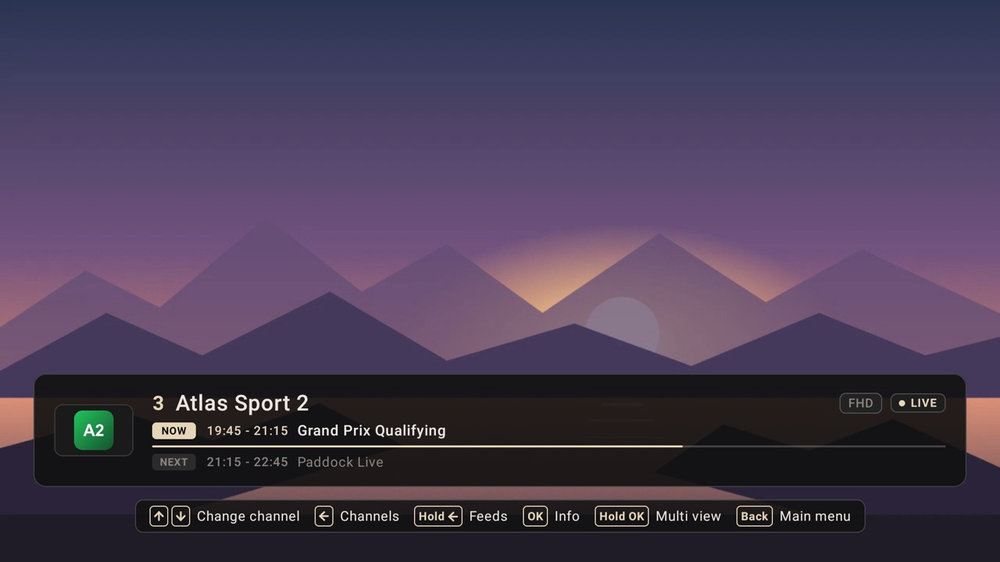

# ggcosta.github.io

Personal site of Gonçalo Galvão da Costa. Plain HTML, CSS and JavaScript with no build step and no dependencies.

## Run locally

```sh
python3 -m http.server 8000
```

Then open http://localhost:8000.

## Editing

- **Your photo:** save it as `assets/photo.jpg` (portrait, about 800×1000). Until then the About card shows "GGC".
- **Project screenshots:** put 16:9 images in `assets/lumen-tv/` or `assets/lumen-home/` and add one `` per image inside that project's `<div class="screen" data-carousel>` in `index.html`, for example:
  ```html
  
  ```
  Add `data-caption="..."` to show a label on the slide. Two or more images turn into a carousel.
- **Email:** change `data-email` and the button label in the Contact section of `index.html`.

## Deploy (GitHub Pages)

1. Create a public repo named `ggcosta.github.io`.
2. Push this folder to `main`.
3. The site goes live at https://ggcosta.github.io (Settings → Pages → "Deploy from a branch", `main` / root, if it isn't enabled automatically).
